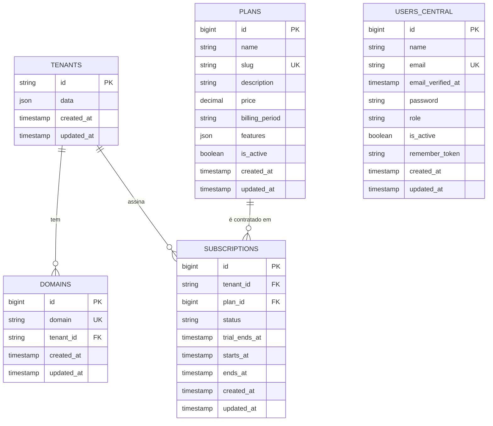
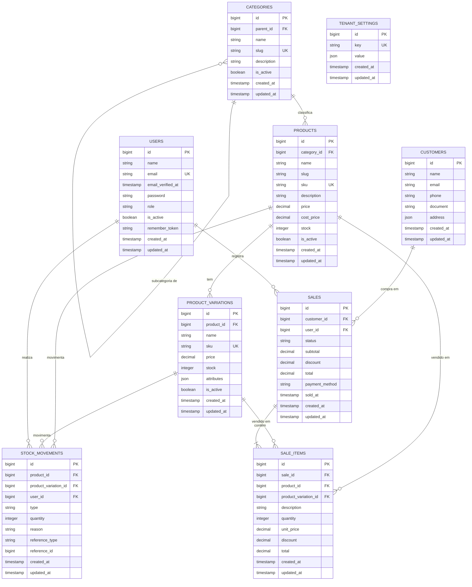

# Zenvyra — Modelo de Dados (ERD)

> **Status:** aprovado · **Versão:** 1.0 · **Última atualização:** 2026-06-14
>
> Este documento é a **fonte de verdade** da modelagem de dados do Zenvyra. Toda
> migration criada nas fases seguintes **deve** seguir a estrutura de campos e os
> relacionamentos aqui descritos. Mudanças no modelo devem ser feitas **primeiro
> neste documento** (com incremento de versão) e só então refletidas em código.

---

## 1. Arquitetura multi-tenant

O Zenvyra usa **multi-tenancy por schema no PostgreSQL** (pacote `stancl/tenancy`,
ver [TASK 02](#)). Existem dois tipos de schema:

| Schema | Onde vive | Conteúdo | Como é criado |
| --- | --- | --- | --- |
| **Central (`public`)** | Banco `zenvyra`, schema `public` | Gestão da plataforma (lojas, domínios, planos, assinaturas, administradores) | `php artisan migrate` (migrations em `database/migrations`) |
| **Tenant (`tenant<id>`)** | Banco `zenvyra`, um schema por loja | Dados operacionais isolados de cada loja | `php artisan tenants:migrate` (migrations em `database/migrations/tenant`) |

**Regras estruturais:**

1. Entidades de **gestão da plataforma** pertencem ao schema **central**:
   `tenants`, `domains`, `plans`, `subscriptions`, `users_central`.
2. Entidades **operacionais da loja** pertencem ao schema de **cada tenant**:
   `users`, `tenant_settings`, `categories`, `products`, `product_variations`,
   `stock_movements`, `customers`, `sales`, `sale_items`.
3. **Não existem chaves estrangeiras entre schemas.** Um schema de tenant é
   autocontido; o vínculo entre os dados de uma loja e o registro central
   (`tenants.id`) é **lógico** (o nome do schema = `tenant` + `tenants.id`), nunca
   uma FK de banco. FKs só existem **dentro do mesmo schema**.
4. Cada tabela operacional do tenant nasce vazia em cada novo schema; o
   isolamento é garantido pelo `search_path` (ver TASK 02).

### Legenda dos diagramas

- `PK` — chave primária · `FK` — chave estrangeira · `UK` — chave única
- Cardinalidade (notação crow's foot do Mermaid):
  - `||--o{` → um-para-muitos (obrigatório de um lado, zero-ou-muitos do outro)
  - `||--|{` → um-para-muitos (obrigatório dos dois lados)
- Tipos abreviados no diagrama (`decimal`, `string`, etc.) são detalhados nas
  tabelas de cada entidade (precisão, nullability, defaults).

---

## 2. Schema central (`public`)

> `USERS_CENTRAL` (administradores da plataforma) não tem FK para `tenants`: são
> usuários globais da plataforma, não pertencem a nenhuma loja.

### 2.1 `tenants` — lojas / clientes da plataforma
> Implementada em `database/migrations/2019_09_15_000010_create_tenants_table.php` (pacote).

| Campo | Tipo | Restrições | Descrição |
| --- | --- | --- | --- |
| `id` | `string` | **PK** | Identificador do tenant; também compõe o nome do schema (`tenant<id>`). |
| `data` | `jsonb` | nullable | Coluna virtual do `stancl/tenancy` (metadados / atributos customizados). |
| `created_at` | `timestamp` | | |
| `updated_at` | `timestamp` | | |

### 2.2 `domains` — domínios/subdomínios que apontam para uma loja
> Implementada em `database/migrations/2019_09_15_000020_create_domains_table.php` (pacote).

| Campo | Tipo | Restrições | Descrição |
| --- | --- | --- | --- |
| `id` | `bigint` (increments) | **PK** | |
| `domain` | `string(255)` | **UK** | Domínio/subdomínio (ex.: `loja-a.zenvyra.com`). |
| `tenant_id` | `string` | **FK → tenants.id**, cascade on update/delete | Loja dona do domínio. |
| `created_at` / `updated_at` | `timestamp` | | |

### 2.3 `plans` — planos comerciais oferecidos
> Implementada em `database/migrations/2026_06_14_000010_create_plans_table.php`.

| Campo | Tipo | Restrições | Descrição |
| --- | --- | --- | --- |
| `id` | `bigint` | **PK** | |
| `name` | `string` | | Nome do plano (ex.: "Pro"). |
| `slug` | `string` | **UK** | Identificador legível (ex.: `pro`). |
| `description` | `text` | nullable | |
| `price` | `decimal(10,2)` | default `0` | Valor por período de cobrança. |
| `billing_period` | `string` | default `monthly` | `monthly` \| `yearly`. |
| `features` | `json` | nullable | Lista de recursos/limites do plano. |
| `is_active` | `boolean` | default `true` | Se o plano está disponível para contratação. |
| `created_at` / `updated_at` | `timestamp` | | |

### 2.4 `subscriptions` — assinatura de um plano por uma loja
> Implementada em `database/migrations/2026_06_14_000020_create_subscriptions_table.php`.

| Campo | Tipo | Restrições | Descrição |
| --- | --- | --- | --- |
| `id` | `bigint` | **PK** | |
| `tenant_id` | `string` | **FK → tenants.id**, cascade on update/delete | Loja assinante. |
| `plan_id` | `bigint` | **FK → plans.id** | Plano contratado. |
| `status` | `string` | default `active` | `active` \| `trialing` \| `past_due` \| `canceled`. |
| `trial_ends_at` | `timestamp` | nullable | Fim do período de teste. |
| `starts_at` | `timestamp` | nullable | Início da vigência. |
| `ends_at` | `timestamp` | nullable | Fim da vigência / cancelamento. |
| `created_at` / `updated_at` | `timestamp` | | |

### 2.5 `users_central` — administradores da plataforma
> **A criar** (fase de administração da plataforma). Não confundir com `users` do tenant.

| Campo | Tipo | Restrições | Descrição |
| --- | --- | --- | --- |
| `id` | `bigint` | **PK** | |
| `name` | `string` | | |
| `email` | `string` | **UK** | |
| `email_verified_at` | `timestamp` | nullable | |
| `password` | `string` | | Hash. |
| `role` | `string` | default `support` | `super_admin` \| `support`. |
| `is_active` | `boolean` | default `true` | |
| `remember_token` | `string(100)` | nullable | |
| `created_at` / `updated_at` | `timestamp` | | |

---

## 3. Schema de tenant (`tenant<id>`)

### 3.1 `users` — usuários/operadores da loja
> **A criar.** Vivem dentro do schema do tenant; o e-mail é único **por loja**.

| Campo | Tipo | Restrições | Descrição |
| --- | --- | --- | --- |
| `id` | `bigint` | **PK** | |
| `name` | `string` | | |
| `email` | `string` | **UK** (dentro do schema) | |
| `email_verified_at` | `timestamp` | nullable | |
| `password` | `string` | | Hash. |
| `role` | `string` | default `owner` | `owner` \| `manager` \| `cashier`. |
| `is_active` | `boolean` | default `true` | |
| `remember_token` | `string(100)` | nullable | |
| `created_at` / `updated_at` | `timestamp` | | |

### 3.2 `tenant_settings` — configurações da loja (chave/valor)
> **A criar.** Modelo chave/valor flexível. Chaves típicas: `store_name`,
> `currency`, `timezone`, `logo_path`, `address`, `fiscal_data`.

| Campo | Tipo | Restrições | Descrição |
| --- | --- | --- | --- |
| `id` | `bigint` | **PK** | |
| `key` | `string` | **UK** | Nome da configuração. |
| `value` | `json` | nullable | Valor (escalar ou estruturado). |
| `created_at` / `updated_at` | `timestamp` | | |

### 3.3 `categories` — categorias de produtos (hierárquicas)
> **A criar.** `parent_id` permite subcategorias (auto-relacionamento).

| Campo | Tipo | Restrições | Descrição |
| --- | --- | --- | --- |
| `id` | `bigint` | **PK** | |
| `parent_id` | `bigint` | **FK → categories.id**, nullable, `nullOnDelete` | Categoria pai. |
| `name` | `string` | | |
| `slug` | `string` | **UK** | |
| `description` | `text` | nullable | |
| `is_active` | `boolean` | default `true` | |
| `created_at` / `updated_at` | `timestamp` | | |

### 3.4 `products` — produtos da loja
> Migration demo mínima já existe em `database/migrations/tenant/2026_06_14_000000_create_products_table.php`
> (`id`, `name`, `sku`, `price`, `stock`, timestamps). **Deve ser expandida** para
> a estrutura abaixo na fase de catálogo.

| Campo | Tipo | Restrições | Descrição |
| --- | --- | --- | --- |
| `id` | `bigint` | **PK** | |
| `category_id` | `bigint` | **FK → categories.id**, nullable, `nullOnDelete` | |
| `name` | `string` | | |
| `slug` | `string` | nullable | |
| `sku` | `string` | **UK**, nullable | Código do produto. |
| `description` | `text` | nullable | |
| `price` | `decimal(10,2)` | default `0` | Preço de venda base. |
| `cost_price` | `decimal(10,2)` | nullable | Custo. |
| `stock` | `integer` | default `0` | Estoque base (quando sem variações). |
| `is_active` | `boolean` | default `true` | |
| `created_at` / `updated_at` | `timestamp` | | |

### 3.5 `product_variations` — variações de um produto
> **A criar.** Ex.: tamanho/cor. Quando há variações, o estoque/preço relevante é o da variação.

| Campo | Tipo | Restrições | Descrição |
| --- | --- | --- | --- |
| `id` | `bigint` | **PK** | |
| `product_id` | `bigint` | **FK → products.id**, `cascadeOnDelete` | |
| `name` | `string` | | Ex.: "Tam. M / Azul". |
| `sku` | `string` | **UK**, nullable | |
| `price` | `decimal(10,2)` | nullable | Sobrepõe `products.price` quando preenchido. |
| `stock` | `integer` | default `0` | |
| `attributes` | `json` | nullable | Ex.: `{ "size": "M", "color": "azul" }`. |
| `is_active` | `boolean` | default `true` | |
| `created_at` / `updated_at` | `timestamp` | | |

### 3.6 `stock_movements` — histórico de movimentações de estoque
> **A criar.** Registra entradas/saídas/ajustes. Aponta para produto **ou** variação.

| Campo | Tipo | Restrições | Descrição |
| --- | --- | --- | --- |
| `id` | `bigint` | **PK** | |
| `product_id` | `bigint` | **FK → products.id**, nullable, `cascadeOnDelete` | |
| `product_variation_id` | `bigint` | **FK → product_variations.id**, nullable, `cascadeOnDelete` | |
| `user_id` | `bigint` | **FK → users.id**, nullable, `nullOnDelete` | Quem fez o lançamento. |
| `type` | `string` | | `in` \| `out` \| `adjustment`. |
| `quantity` | `integer` | | Quantidade movimentada (sempre positiva). |
| `reason` | `string` | nullable | `purchase` \| `sale` \| `return` \| `adjustment`. |
| `reference_type` | `string` | nullable | Origem (ex.: `sale`) — referência lógica. |
| `reference_id` | `bigint` | nullable | Id do registro de origem. |
| `created_at` / `updated_at` | `timestamp` | | |

### 3.7 `customers` — clientes da loja
> **A criar.**

| Campo | Tipo | Restrições | Descrição |
| --- | --- | --- | --- |
| `id` | `bigint` | **PK** | |
| `name` | `string` | | |
| `email` | `string` | nullable | |
| `phone` | `string` | nullable | |
| `document` | `string` | nullable | CPF/CNPJ. |
| `address` | `json` | nullable | Endereço estruturado. |
| `created_at` / `updated_at` | `timestamp` | | |

### 3.8 `sales` — vendas (pedidos)
> **A criar.**

| Campo | Tipo | Restrições | Descrição |
| --- | --- | --- | --- |
| `id` | `bigint` | **PK** | |
| `customer_id` | `bigint` | **FK → customers.id**, nullable, `nullOnDelete` | |
| `user_id` | `bigint` | **FK → users.id**, nullable, `nullOnDelete` | Operador/caixa. |
| `status` | `string` | default `completed` | `draft` \| `completed` \| `canceled` \| `refunded`. |
| `subtotal` | `decimal(10,2)` | default `0` | Soma dos itens antes do desconto. |
| `discount` | `decimal(10,2)` | default `0` | Desconto aplicado à venda. |
| `total` | `decimal(10,2)` | default `0` | `subtotal - discount`. |
| `payment_method` | `string` | nullable | `cash` \| `card` \| `pix` \| ... |
| `sold_at` | `timestamp` | nullable | Data/hora efetiva da venda. |
| `created_at` / `updated_at` | `timestamp` | | |

### 3.9 `sale_items` — itens de uma venda
> **A criar.** Cada item guarda um *snapshot* (`description`, `unit_price`) para
> preservar o histórico mesmo se o produto mudar depois.

| Campo | Tipo | Restrições | Descrição |
| --- | --- | --- | --- |
| `id` | `bigint` | **PK** | |
| `sale_id` | `bigint` | **FK → sales.id**, `cascadeOnDelete` | |
| `product_id` | `bigint` | **FK → products.id**, nullable, `nullOnDelete` | |
| `product_variation_id` | `bigint` | **FK → product_variations.id**, nullable, `nullOnDelete` | |
| `description` | `string` | | Snapshot do nome do produto/variação. |
| `quantity` | `integer` | default `1` | |
| `unit_price` | `decimal(10,2)` | | Preço unitário no momento da venda. |
| `discount` | `decimal(10,2)` | default `0` | |
| `total` | `decimal(10,2)` | | `quantity * unit_price - discount`. |
| `created_at` / `updated_at` | `timestamp` | | |

---

## 4. Resumo dos relacionamentos

### Central (`public`)
- `tenants (1) → (N) domains` — uma loja pode ter vários domínios.
- `tenants (1) → (N) subscriptions` — histórico de assinaturas por loja.
- `plans (1) → (N) subscriptions` — um plano é contratado por várias lojas.
- `users_central` — sem relacionamento com lojas (administração global).

### Tenant (`tenant<id>`)
- `categories (1) → (N) categories` — auto-relacionamento (subcategorias).
- `categories (1) → (N) products`.
- `products (1) → (N) product_variations`.
- `products / product_variations (1) → (N) stock_movements`.
- `products / product_variations (1) → (N) sale_items`.
- `customers (1) → (N) sales`.
- `users (1) → (N) sales` (operador) e `users (1) → (N) stock_movements`.
- `sales (1) → (N) sale_items` (composição).

### Entre schemas
- **Nenhuma FK física.** Vínculo lógico: `schema "tenant<id>"` ↔ `tenants.id`.

---

## 5. Convenções para migrations futuras

Toda nova migration **deve** referenciar este ERD e seguir estas regras:

1. **Local correto pelo schema:**
   - Entidade central → `database/migrations/` (roda com `php artisan migrate`).
   - Entidade de tenant → `database/migrations/tenant/` (roda com `php artisan tenants:migrate`).
2. **Sem FK entre schemas.** Tabelas de tenant não referenciam tabelas centrais
   por FK; o vínculo com a loja é o próprio schema.
3. **Tipos e nomes idênticos aos das tabelas acima** (precisão de `decimal(10,2)`,
   nullability, defaults e nomes de coluna `snake_case`).
4. **Chaves estrangeiras** usam `foreignId(...)->constrained()` com a política de
   exclusão indicada (`cascadeOnDelete` / `nullOnDelete`) conforme a coluna.
5. **`id` `bigint` auto-incremento** em todas as entidades, exceto `tenants.id`
   (`string`) e `domains.id` (`increments`/`int`) por imposição do pacote.
6. **Timestamps** (`created_at`, `updated_at`) em todas as tabelas.
7. Mudou o modelo? Atualize **este documento primeiro**, incremente a versão no
   topo e descreva a alteração no histórico abaixo.

---

## 6. Histórico de versões

| Versão | Data | Autor | Alterações |
| --- | --- | --- | --- |
| 1.0 | 2026-06-14 | Time Zenvyra | Versão inicial: entidades centrais e de tenant, diagramas e convenções. |
