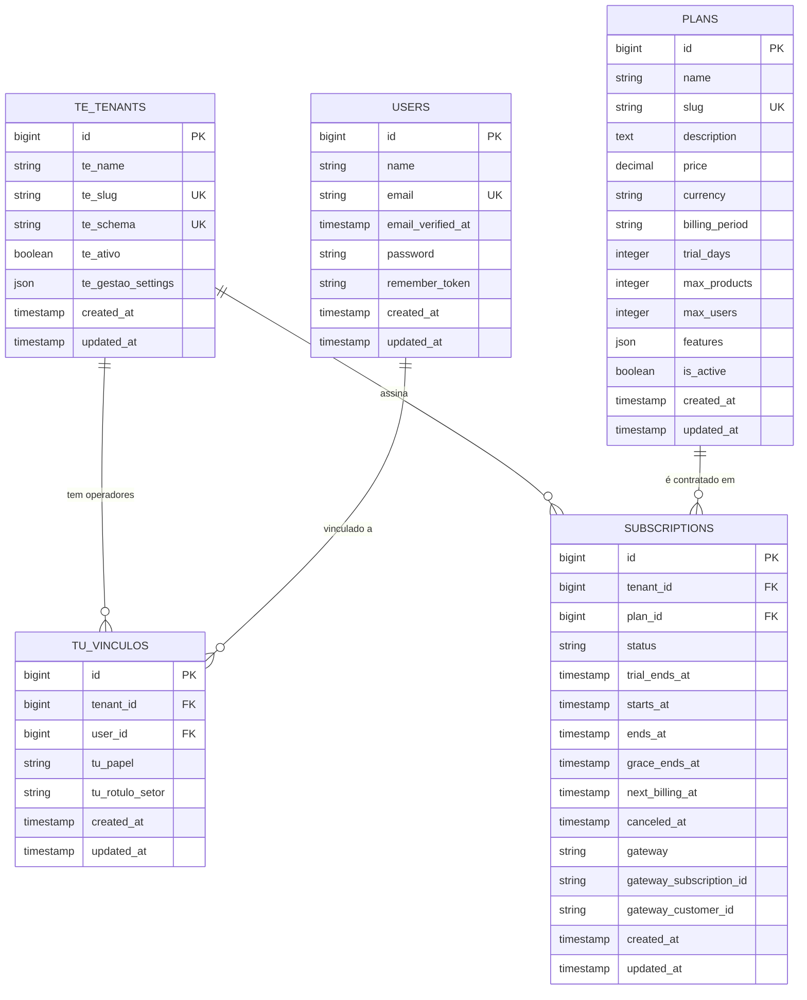
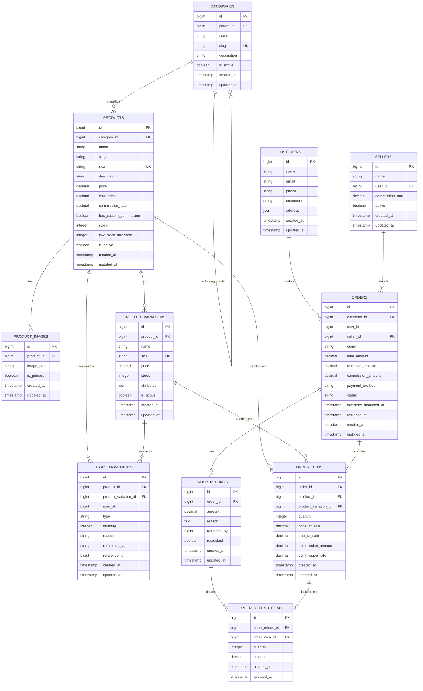

# Zenvyra — Modelo de Dados (ERD)

> **Status:** aprovado · **Versão:** 1.1 · **Última atualização:** 2026-06-19
>
> Este documento é a **fonte de verdade** da modelagem de dados do Zenvyra. Toda
> migration criada nas fases seguintes **deve** seguir a estrutura de campos e os
> relacionamentos aqui descritos. Mudanças no modelo devem ser feitas **primeiro
> neste documento** (com incremento de versão) e só então refletidas em código.

---

## 1. Arquitetura multi-tenant

O Zenvyra usa **multi-tenancy por schema no PostgreSQL** com implementação própria
via `TenantSchemaManager` (sem pacotes de terceiros). Existem dois tipos de schema:

| Schema | Onde vive | Conteúdo | Como é criado |
| --- | --- | --- | --- |
| **Central (`public`)** | Banco `zenvyra`, schema `public` | Gestão da plataforma (lojas, planos, assinaturas, usuários/operadores) | `php artisan migrate` (migrations em `database/migrations`) |
| **Tenant (`tenant<id>`)** | Banco `zenvyra`, um schema por loja | Dados operacionais isolados de cada loja | `php artisan tenants:migrate` (migrations em `database/migrations/tenant`) |

**Regras estruturais:**

1. Entidades de **gestão da plataforma** pertencem ao schema **central**:
   `te_tenants`, `tu_vinculos`, `plans`, `subscriptions`, `users`.
2. Entidades **operacionais da loja** pertencem ao schema de **cada tenant**:
   `categories`, `products`, `product_images`, `product_variations`,
   `stock_movements`, `customers`, `sellers`, `orders`, `order_items`,
   `order_refunds`, `order_refund_items`.
3. **Não existem chaves estrangeiras entre schemas.** Um schema de tenant é
   autocontido; o vínculo entre os dados de uma loja e o registro central
   (`te_tenants.id`) é **lógico** (o `search_path` é ajustado por requisição),
   nunca uma FK de banco. FKs só existem **dentro do mesmo schema**.
4. Cada tabela operacional do tenant nasce vazia em cada novo schema; o
   isolamento é garantido pelo `search_path` (ver `TenantSchemaManager`).

### Legenda dos diagramas

- `PK` — chave primária · `FK` — chave estrangeira · `UK` — chave única
- Cardinalidade (notação crow's foot do Mermaid):
  - `||--o{` → um-para-muitos (obrigatório de um lado, zero-ou-muitos do outro)
  - `||--|{` → um-para-muitos (obrigatório dos dois lados)
- Tipos abreviados no diagrama (`decimal`, `string`, etc.) são detalhados nas
  tabelas de cada entidade (precisão, nullability, defaults).

---

## 2. Schema central (`public`)

> `USERS` são os operadores/administradores da plataforma no schema central.
> O vínculo de um operador com uma loja específica é registrado em `TU_VINCULOS`.

### 2.1 `te_tenants` — lojas / clientes da plataforma
> Implementada em `database/migrations/2026_06_14_000100_create_te_tenants_table.php`.

| Campo | Tipo | Restrições | Descrição |
| --- | --- | --- | --- |
| `id` | `bigint` (increments) | **PK** | |
| `te_name` | `string` | | Nome da loja. |
| `te_slug` | `string` | **UK** | Identificador legível da loja (ex.: `minha-loja`). |
| `te_schema` | `string` | **UK** | Nome do schema PostgreSQL da loja (ex.: `tenant42`). |
| `te_ativo` | `boolean` | default `true` | Se a loja está ativa na plataforma. |
| `te_gestao_settings` | `jsonb` | nullable | Configurações do painel de gestão da loja. |
| `created_at` / `updated_at` | `timestamp` | | |

### 2.2 `tu_vinculos` — vínculo entre usuário e loja
> Implementada em `database/migrations/2026_06_14_000200_create_tu_vinculos_table.php`.

| Campo | Tipo | Restrições | Descrição |
| --- | --- | --- | --- |
| `id` | `bigint` (increments) | **PK** | |
| `tenant_id` | `bigint` | **FK → te_tenants.id**, cascade on delete | Loja. |
| `user_id` | `bigint` | **FK → users.id**, cascade on delete | Usuário. |
| `tu_papel` | `string` | **UK(tenant_id, user_id)** | Papel do usuário na loja: `administrador_cliente` \| `leader` \| `vendedor`. |
| `tu_rotulo_setor` | `string` | nullable | Rótulo de setor customizado. |
| `created_at` / `updated_at` | `timestamp` | | |

### 2.3 `plans` — planos comerciais oferecidos
> Implementada em `database/migrations/2026_06_14_000300_create_plans_table.php` +
> `2026_06_16_022429_add_billing_fields_to_plans_table.php`.

| Campo | Tipo | Restrições | Descrição |
| --- | --- | --- | --- |
| `id` | `bigint` | **PK** | |
| `name` | `string` | | Nome do plano (ex.: "Pro"). |
| `slug` | `string` | **UK** | Identificador legível (ex.: `pro`). |
| `description` | `text` | nullable | |
| `price` | `decimal(10,2)` | default `0` | Valor por período de cobrança. |
| `currency` | `string(3)` | default `BRL` | Moeda (ISO 4217). |
| `billing_period` | `string` | default `monthly` | `monthly` \| `yearly`. |
| `trial_days` | `integer` | default `0` | Dias de período de teste. |
| `max_products` | `integer` | nullable | Limite de produtos (null = ilimitado). |
| `max_users` | `integer` | nullable | Limite de usuários (null = ilimitado). |
| `features` | `json` | nullable | Lista de recursos/limites do plano. |
| `is_active` | `boolean` | default `true` | Se o plano está disponível para contratação. |
| `created_at` / `updated_at` | `timestamp` | | |

### 2.4 `subscriptions` — assinatura de um plano por uma loja
> Implementada em `database/migrations/2026_06_14_000400_create_subscriptions_table.php` +
> `2026_06_16_022437_add_lifecycle_fields_to_subscriptions_table.php`.

| Campo | Tipo | Restrições | Descrição |
| --- | --- | --- | --- |
| `id` | `bigint` | **PK** | |
| `tenant_id` | `bigint` | **FK → te_tenants.id**, cascade on delete | Loja assinante. |
| `plan_id` | `bigint` | **FK → plans.id**, restrict on delete | Plano contratado. |
| `status` | `string` | default `active` | `active` \| `trialing` \| `past_due` \| `expired` \| `canceled`. |
| `trial_ends_at` | `timestamp` | nullable | Fim do período de teste. |
| `starts_at` | `timestamp` | nullable | Início da vigência. |
| `ends_at` | `timestamp` | nullable | Fim da vigência do ciclo atual. |
| `grace_ends_at` | `timestamp` | nullable | Fim da tolerância após `ends_at`. |
| `next_billing_at` | `timestamp` | nullable | Data da próxima cobrança. |
| `canceled_at` | `timestamp` | nullable | Data do cancelamento. |
| `gateway` | `string` | nullable | Identificador do gateway (ex.: `stripe`). |
| `gateway_subscription_id` | `string` | nullable | ID da assinatura no gateway. |
| `gateway_customer_id` | `string` | nullable | ID do cliente no gateway. |
| `created_at` / `updated_at` | `timestamp` | | |

### 2.5 `users` — usuários/operadores da plataforma
> Implementada em `database/migrations/0001_01_01_000000_create_users_table.php`.

| Campo | Tipo | Restrições | Descrição |
| --- | --- | --- | --- |
| `id` | `bigint` | **PK** | |
| `name` | `string` | | |
| `email` | `string` | **UK** | |
| `email_verified_at` | `timestamp` | nullable | |
| `password` | `string` | | Hash. |
| `remember_token` | `string(100)` | nullable | |
| `created_at` / `updated_at` | `timestamp` | | |

---

## 3. Schema de tenant (`tenant<id>`)

### 3.1 `categories` — categorias de produtos (hierárquicas)
> Implementada em `database/migrations/tenant/2026_06_14_100100_create_categories_table.php`.

| Campo | Tipo | Restrições | Descrição |
| --- | --- | --- | --- |
| `id` | `bigint` | **PK** | |
| `parent_id` | `bigint` | **FK → categories.id**, nullable, `nullOnDelete` | Categoria pai. |
| `name` | `string` | | |
| `slug` | `string` | **UK** | |
| `description` | `text` | nullable | |
| `is_active` | `boolean` | default `true` | |
| `created_at` / `updated_at` | `timestamp` | | |

### 3.2 `products` — produtos da loja
> Implementada em `database/migrations/tenant/2026_06_14_100200_create_products_table.php` +
> adições em `2026_06_15_032538`, `2026_06_15_033054`, `2026_06_16_053816`.

| Campo | Tipo | Restrições | Descrição |
| --- | --- | --- | --- |
| `id` | `bigint` | **PK** | |
| `category_id` | `bigint` | **FK → categories.id**, nullable, `nullOnDelete` | |
| `name` | `string` | | |
| `slug` | `string` | nullable | |
| `sku` | `string` | **UK**, nullable | Código do produto. |
| `description` | `text` | nullable | |
| `price` | `decimal(10,2)` | default `0` | Preço de venda base. |
| `cost_price` | `decimal(10,2)` | nullable | Custo. |
| `commission_rate` | `decimal(5,2)` | nullable | Comissão específica do produto (%). |
| `has_custom_commission` | `boolean` | default `false` | Se usa comissão própria ao invés da do vendedor. |
| `stock` | `integer` | default `0` | Estoque base (quando sem variações). |
| `low_stock_threshold` | `integer` | default `0` | Limiar de alerta de estoque baixo. |
| `is_active` | `boolean` | default `true` | |
| `created_at` / `updated_at` | `timestamp` | | |

### 3.3 `product_images` — imagens de um produto
> Implementada em `database/migrations/tenant/2026_06_14_100300_create_product_images_table.php` +
> `2026_06_15_035809_add_is_primary_to_product_images_table.php`.

| Campo | Tipo | Restrições | Descrição |
| --- | --- | --- | --- |
| `id` | `bigint` | **PK** | |
| `product_id` | `bigint` | **FK → products.id**, `cascadeOnDelete` | |
| `image_path` | `string` | | Caminho do arquivo no storage. |
| `is_primary` | `boolean` | default `false` | Imagem de capa do produto. |
| `created_at` / `updated_at` | `timestamp` | | |

### 3.4 `product_variations` — variações de um produto
> Implementada em `database/migrations/tenant/2026_06_14_100400_create_product_variations_table.php`.

| Campo | Tipo | Restrições | Descrição |
| --- | --- | --- | --- |
| `id` | `bigint` | **PK** | |
| `product_id` | `bigint` | **FK → products.id**, `cascadeOnDelete` | |
| `name` | `string` | | Ex.: "Tam. M / Azul". |
| `sku` | `string` | **UK**, nullable | |
| `price` | `decimal(10,2)` | nullable | Sobrepõe `products.price` quando preenchido. |
| `stock` | `integer` | default `0` | |
| `attributes` | `json` | nullable | Ex.: `{ "size": "M", "color": "azul" }`. |
| `is_active` | `boolean` | default `true` | |
| `created_at` / `updated_at` | `timestamp` | | |

### 3.5 `stock_movements` — histórico de movimentações de estoque
> Implementada em `database/migrations/tenant/2026_06_15_033100_create_stock_movements_table.php`.

| Campo | Tipo | Restrições | Descrição |
| --- | --- | --- | --- |
| `id` | `bigint` | **PK** | |
| `product_id` | `bigint` | **FK → products.id**, nullable, `cascadeOnDelete` | |
| `product_variation_id` | `bigint` | **FK → product_variations.id**, nullable, `cascadeOnDelete` | |
| `user_id` | `bigint` | nullable, index (sem FK — referência lógica ao schema central) | Quem fez o lançamento. |
| `type` | `string` | | `in` \| `out` \| `adjustment`. |
| `quantity` | `integer` | | Quantidade movimentada (sempre positiva). |
| `reason` | `string` | nullable | `purchase` \| `sale` \| `return` \| `adjustment`. |
| `reference_type` | `string` | nullable | Origem (ex.: `order`) — referência lógica. |
| `reference_id` | `bigint` | nullable | Id do registro de origem. |
| `created_at` / `updated_at` | `timestamp` | | |

### 3.6 `customers` — clientes da loja
> Implementada em `database/migrations/tenant/2026_06_14_100500_create_customers_table.php`.

| Campo | Tipo | Restrições | Descrição |
| --- | --- | --- | --- |
| `id` | `bigint` | **PK** | |
| `name` | `string` | | |
| `email` | `string` | nullable | |
| `phone` | `string` | nullable | |
| `document` | `string` | nullable | CPF/CNPJ. |
| `address` | `json` | nullable | Endereço estruturado. |
| `created_at` / `updated_at` | `timestamp` | | |

### 3.7 `sellers` — vendedores da loja
> Implementada em `database/migrations/tenant/2026_06_16_053815_create_sellers_table.php`.

| Campo | Tipo | Restrições | Descrição |
| --- | --- | --- | --- |
| `id` | `bigint` | **PK** | |
| `name` | `string` | | |
| `user_id` | `bigint` | **UK**, nullable, index (sem FK — referência lógica ao schema central) | Usuário vinculado. |
| `commission_rate` | `decimal(5,2)` | default `0` | Taxa de comissão padrão do vendedor (%). |
| `active` | `boolean` | default `true` | |
| `created_at` / `updated_at` | `timestamp` | | |

### 3.8 `orders` — pedidos / vendas
> Implementada em `database/migrations/tenant/2026_06_14_100600_create_orders_table.php` +
> adições em `2026_06_14_221054`, `2026_06_15_010437`, `2026_06_16_053816`, `2026_06_16_053817`.

| Campo | Tipo | Restrições | Descrição |
| --- | --- | --- | --- |
| `id` | `bigint` | **PK** | |
| `customer_id` | `bigint` | **FK → customers.id**, nullable, `nullOnDelete` | |
| `user_id` | `bigint` | nullable, index (sem FK — referência lógica ao schema central) | Operador/caixa. |
| `seller_id` | `bigint` | **FK → sellers.id**, nullable, `nullOnDelete` | Vendedor que atendeu. |
| `origin` | `string` | default `balcao` | `balcao` \| outros canais. |
| `total_amount` | `decimal(10,2)` | default `0` | Valor total do pedido. |
| `refunded_amount` | `decimal(10,2)` | default `0` | Valor total devolvido. |
| `commission_amount` | `decimal(10,2)` | default `0` | Comissão calculada do vendedor. |
| `payment_method` | `string` | nullable | `cash` \| `card` \| `pix` \| ... |
| `status` | `string` | default `pending` | `pending` \| `completed` \| `canceled` \| `refunded`. |
| `inventory_deducted_at` | `timestamp` | nullable | Quando o estoque foi baixado. |
| `refunded_at` | `timestamp` | nullable | Quando o reembolso foi processado. |
| `created_at` / `updated_at` | `timestamp` | | |

### 3.9 `order_items` — itens de um pedido
> Implementada em `database/migrations/tenant/2026_06_14_100700_create_order_items_table.php` +
> `2026_06_16_053817_add_commission_fields_to_order_items_table.php`.

| Campo | Tipo | Restrições | Descrição |
| --- | --- | --- | --- |
| `id` | `bigint` | **PK** | |
| `order_id` | `bigint` | **FK → orders.id**, `cascadeOnDelete` | |
| `product_id` | `bigint` | **FK → products.id**, `restrictOnDelete` | |
| `product_variation_id` | `bigint` | **FK → product_variations.id**, nullable, `nullOnDelete` | |
| `quantity` | `integer` | default `1` | |
| `price_at_sale` | `decimal(10,2)` | default `0` | Preço unitário no momento da venda. |
| `cost_at_sale` | `decimal(10,2)` | default `0` | Custo unitário no momento da venda. |
| `commission_amount` | `decimal(10,2)` | default `0` | Comissão calculada para este item. |
| `commission_rate` | `decimal(5,2)` | default `0` | Taxa aplicada neste item (%). |
| `created_at` / `updated_at` | `timestamp` | | |

### 3.10 `order_refunds` — reembolsos de um pedido
> Implementada em `database/migrations/tenant/2026_06_15_010442_create_order_refunds_table.php`.

| Campo | Tipo | Restrições | Descrição |
| --- | --- | --- | --- |
| `id` | `bigint` | **PK** | |
| `order_id` | `bigint` | **FK → orders.id**, `cascadeOnDelete` | |
| `amount` | `decimal(10,2)` | default `0` | Valor total do reembolso. |
| `reason` | `text` | | Motivo do reembolso. |
| `refunded_by` | `bigint` | nullable, index (sem FK — referência lógica ao schema central) | Usuário que processou. |
| `restocked` | `boolean` | default `false` | Se o estoque foi reposto. |
| `created_at` / `updated_at` | `timestamp` | | |

### 3.11 `order_refund_items` — itens de um reembolso
> Implementada em `database/migrations/tenant/2026_06_15_010443_create_order_refund_items_table.php`.

| Campo | Tipo | Restrições | Descrição |
| --- | --- | --- | --- |
| `id` | `bigint` | **PK** | |
| `order_refund_id` | `bigint` | **FK → order_refunds.id**, `cascadeOnDelete` | |
| `order_item_id` | `bigint` | **FK → order_items.id**, `restrictOnDelete` | |
| `quantity` | `integer` | default `1` | |
| `amount` | `decimal(10,2)` | default `0` | Valor reembolsado neste item. |
| `created_at` / `updated_at` | `timestamp` | | |

---

## 4. Resumo dos relacionamentos

### Central (`public`)
- `te_tenants (1) → (N) tu_vinculos` — usuários vinculados à loja.
- `te_tenants (1) → (N) subscriptions` — histórico de assinaturas por loja.
- `plans (1) → (N) subscriptions` — um plano é contratado por várias lojas.
- `users (1) → (N) tu_vinculos` — um usuário pode ser operador em várias lojas.

### Tenant (`tenant<id>`)
- `categories (1) → (N) categories` — auto-relacionamento (subcategorias).
- `categories (1) → (N) products`.
- `products (1) → (N) product_images`.
- `products (1) → (N) product_variations`.
- `products / product_variations (1) → (N) stock_movements`.
- `products / product_variations (1) → (N) order_items`.
- `customers (1) → (N) orders`.
- `sellers (1) → (N) orders`.
- `orders (1) → (N) order_items` (composição).
- `orders (1) → (N) order_refunds`.
- `order_refunds (1) → (N) order_refund_items`.
- `order_items (1) → (N) order_refund_items`.

### Entre schemas
- **Nenhuma FK física.** Vínculo lógico: o `search_path` da conexão é ajustado
  por requisição via `TenantSchemaManager`. Colunas `user_id` em tabelas de
  tenant referenciam `public.users` apenas logicamente (sem `constrainted()`).

---

## 5. Convenções para migrations futuras

Toda nova migration **deve** referenciar este ERD e seguir estas regras:

1. **Local correto pelo schema:**
   - Entidade central → `database/migrations/` (roda com `php artisan migrate`).
   - Entidade de tenant → `database/migrations/tenant/` (roda com `php artisan tenants:migrate`).
2. **Sem FK entre schemas.** Tabelas de tenant não referenciam tabelas centrais
   por FK; colunas `user_id` de tenant ficam sem `constrained()`.
3. **Tipos e nomes idênticos aos das tabelas acima** (precisão de `decimal(10,2)`,
   nullability, defaults e nomes de coluna `snake_case`).
4. **Chaves estrangeiras** usam `foreignId(...)->constrained()` com a política de
   exclusão indicada (`cascadeOnDelete` / `nullOnDelete` / `restrictOnDelete`)
   conforme a coluna.
5. **`id` `bigint` auto-incremento** em todas as entidades.
6. **Timestamps** (`created_at`, `updated_at`) em todas as tabelas.
7. Mudou o modelo? Atualize **este documento primeiro**, incremente a versão no
   topo e descreva a alteração no histórico abaixo.

---

## 6. Histórico de versões

| Versão | Data | Autor | Alterações |
| --- | --- | --- | --- |
| 1.0 | 2026-06-14 | Time Zenvyra | Versão inicial: entidades centrais e de tenant, diagramas e convenções. |
| 1.1 | 2026-06-19 | Time Zenvyra | Corrigida referência ao `stancl/tenancy` (implementação é própria via `TenantSchemaManager`). Renomeadas tabelas centrais para `te_tenants` / `tu_vinculos` e tabelas de tenant de `sales`/`sale_items` para `orders`/`order_items`. Adicionadas tabelas `order_refunds`, `order_refund_items`, `product_images`, `sellers`. Removidos marcadores "A criar" de tabelas já implementadas. Atualizado schema de `subscriptions` com campos do ciclo de vida (`grace_ends_at`, `next_billing_at`, `canceled_at`, campos de gateway). Atualizado schema de `plans` com `currency`, `trial_days`, `max_products`, `max_users`. |
